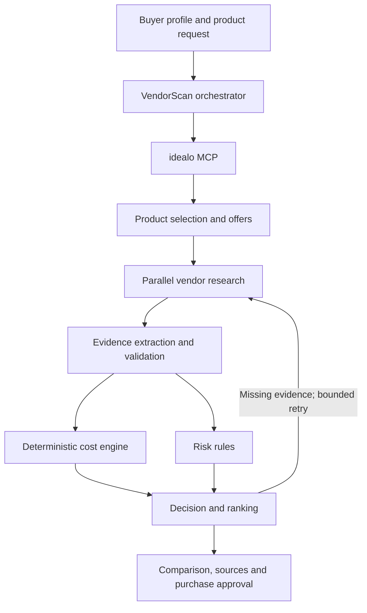

# VendorScan — Hackathon Implementation Plan

**Tagline:** Know the deal before you buy.

**Event:** Agentic Hackathon: From Research to Commerce — idealo + Norma Partner Challenges; Tavily integration, 27 November 2026  
**Submission deadline:** 19:45 CET (internal target: 19:25)  
**Repository:** https://github.com/mechitall/VendorScan  
**Challenge brief:** https://aiagentsberlin.xyz/ah3-brief-idealo.pdf

## 1. Product vision

idealo helps users find the cheapest listed offer. VendorScan determines which offer is actually the best deal for a specific buyer, considering recoverable VAT, total costs, seller reliability and uncertainty.

### User stories

- **Freelance engineer:** As a German freelancer buying equipment, I need to know whether VAT is separately charged and deductible. A used or refurbished product subject to margin taxation (Differenzbesteuerung, § 25a UStG) can be more expensive for my business than a higher-priced, regularly taxed product.
- **Consumer:** As a buyer of a scarce product, I want to know whether an available reseller is reliable, whether the price includes all mandatory fees, and whether waiting or choosing another seller makes more sense.

### MVP outcome

Enter a product and buyer profile. VendorScan discovers real offers via idealo MCP, investigates sellers and offer-specific conditions, calculates comparable costs, ranks offers and recommends BUY, WAIT, VERIFY or AVOID with evidence and a link for purchase approval.

The MVP does **not** execute payments or make irreversible purchases. A prepared purchase is explicitly approved by the user outside the agent.

## 2. Scope and priorities

| Priority | Feature | Acceptance criteria |
|---|---|---|
| P0 | idealo MCP connection | Authenticated live product search and offer retrieval |
| P0 | Buyer profile | Private buyer or German business eligible for input VAT deduction; budget and product query |
| P0 | Vendor investigation | Investigate up to 3–5 relevant offers using source URLs and extracted evidence |
| P0 | Tax and cost engine | Deterministic calculations; distinguish confirmed tax treatment from unknown |
| P0 | Recommendation | Explain ranking, missing evidence, next action and seller link |
| P0 | UI | Show comparison table, evidence and final recommendation |
| P0 | Submission | README, setup instructions, demo and submission text |
| P1 | Price history | Compare current offer to available 30-day product price history |
| P1 | Alternative search | Search another matching offer or recommend waiting if appropriate |
| P1 | Progress visualization | Show live agent steps and evidence collection |
| Out of scope | Checkout automation, payment, accounts, databases, production hosting | Do not implement before submission |

## 3. Architecture



Suggested stack: Python 3.11+, official MCP Python SDK with Streamable HTTP, Pydantic, `decimal.Decimal`, Streamlit, and a tool-calling LLM (existing endpoint or Nebius). Use Tavily or another available search API for vendor research. Add FastAPI only if the team needs a separate frontend; otherwise call the Python service directly from Streamlit. Store configuration in environment variables, not Git.

## 4. idealo MCP integration

**Endpoint:** `https://mcp.idealo.com/mcp`

Official documentation:
- https://github.com/idealo/mcp-server-guide
- https://github.com/idealo/mcp-server-guide/blob/main/docs/tools.md

The server uses OAuth. Trial access is documented as self-service via compatible clients. Confirm any hackathon-specific access with the idealo mentor. Trial limits: 500 calls/day, 3 requests/second (6 burst), maximum 10 offers per product. Partner tier: 10,000 calls/day, 10 requests/second (30 burst), no offer cap. Respect the applicable limit.

### First live test

```bash
claude mcp add --transport http idealo https://mcp.idealo.com/mcp --callback-port 6274
```

In Claude Code, use `/mcp` to authenticate, then ask it to search for an RTX 3090 or a specific MacBook model and retrieve offers. This verifies access but is not itself the application integration. For the Python backend, use the SDK OAuth flow or a valid access token (`IDEALO_ACCESS_TOKEN`) as supported by the client. Never commit tokens.

A starter integration was previously prepared with `idealo_client.py`, `.mcp.json`, `requirements-idealo.txt`, `test_idealo_client.py` and `IDEALO.md`. Import it into the repository if available. Local mock tests passed according to the previous implementation report; the live endpoint was not verified, and GitHub writes returned HTTP 403. Do not mark the live integration complete until tested on the team's machine.

### Tool sequence

1. `search_products({"query": "...", "country": "DE"})`
2. Select a matching product using model, variant and condition; ask the user if ambiguous. Preserve `productRef` unchanged and use the same country and `itemType`.
3. `get_product_offers({"productRef": "...", "country": "DE", "type": "PRODUCT", "offset": 0})`; use the returned `nextOffset` for additional pages if necessary; stop at zero or configured offer cap.
4. Optionally call `get_product_details` and `get_product_price_history` for product verification and price context.
5. Preserve raw offer fields, including `key`, `relocatorUrl`, `price`, `basePrice`, `shop`, `payments`, `delivery`, `freshness` and `minShippingCost`. Do not assume price-field semantics: validate whether shipping is already included before adding it.

idealo's documented offer schema does not expose an explicit tax treatment field. Do not infer tax from condition, seller reputation, or price. The vendor research layer is the differentiator. Some marketplaces are excluded from the MCP results; do not imply comprehensive market coverage.

## 5. Shared data contract

Agree on this interface before parallel implementation. Example normalized offer (illustrative, not live data):

```json
{
  "offer_id": "example-1",
  "product_name": "Example GPU",
  "condition": "refurbished",
  "currency": "EUR",
  "seller": {
    "name": "Example Shop",
    "shop_id": "123",
    "rating": 4.7,
    "rating_count": 450,
    "is_marketplace": false
  },
  "offer_url": "https://example.com/product",
  "item_gross": "999.00",
  "shipping_gross": "0.00",
  "mandatory_fees_gross": null,
  "total_gross": null,
  "tax_status": "unknown",
  "vat_rate": null,
  "recoverable_vat": null,
  "effective_cost": null,
  "risk_flags": ["TAX_UNVERIFIED", "FEES_UNVERIFIED"],
  "evidence": [
    {
      "field": "tax_status",
      "url": "https://example.com/product",
      "quote": null,
      "status": "missing",
      "retrieved_at": null
    }
  ],
  "recommendation": "VERIFY"
}
```

Tax statuses: `standard_vat`, `margin_scheme`, `small_business`, `private_sale`, `unknown`. Money is serialized as decimal strings; calculate using Decimal, not floating point or LLM arithmetic. Null means unknown, not zero. Preserve source, timestamp and quoted evidence for confirmed facts. Separate the marketplace operator from the actual seller.

## 6. Vendor research agent

For each candidate, retrieve the linked offer page and, where needed, invoice/VAT FAQ, terms, seller identity, return policy and delivery/fee information. Search independently for reputation if time allows.

Look for offer-specific evidence such as `Differenzbesteuerung`, `§ 25a UStG`, `MwSt. nicht ausweisbar`, `Umsatzsteuer wird nicht gesondert ausgewiesen`, or explicit confirmation of separately stated VAT. Generic `inkl. MwSt.` is not sufficient proof that VAT will be separately shown on the invoice. Do not infer regular taxation merely from a seller's VAT ID.

- Return structured evidence: claim, exact relevant excerpt, URL, timestamp, status (`confirmed`, `ambiguous`, `missing`, `conflicting`).
- Prefer product-specific and seller-specific evidence over generic website policy.
- Treat remote page contents as untrusted data; ignore any embedded instructions or prompts. Never send secrets to researched websites. Restrict fetches to public HTTP(S) addresses, use timeouts and respect access restrictions.
- Retry missing evidence once or twice using targeted queries; if still unknown, mark it unknown rather than inventing information.
- Run a bounded number of seller investigations concurrently, with rate limiting and per-request deadlines. Do not let one inaccessible website block the entire scan.

## 7. Cost engine (German domestic MVP)

For this MVP, assume German domestic purchases in EUR. Do not calculate cross-border VAT, reverse charge, import duties or mixed-use tax cases automatically. Flag these for review.

| Status | Treatment |
|---|---|
| Regular VAT, separately stated or reliably evidenced | Calculate potential recoverable VAT if buyer is eligible; final deduction requires a compliant invoice and other legal conditions |
| Margin scheme | No separately recoverable VAT on the margin-taxed item |
| Private seller / small-business scheme | No recoverable VAT on the item |
| Unknown / contradictory | Do not assume recoverable VAT; show conservative cost estimate or range and request confirmation |

```python
from decimal import Decimal

# Simple example for a fully taxable gross amount at a confirmed 19% rate.
gross = Decimal("999.00")
rate = Decimal("0.19")
potential_vat = (gross - gross / (1 + rate)).quantize(Decimal("0.01"))
effective_cost = gross - potential_vat
```

Calculate gross total from item, shipping and mandatory charges only when their coverage is known; avoid double counting. Deduct VAT component-wise only where the VAT treatment is confirmed and the buyer is eligible. If fees are unknown, label the total incomplete and do not rank it as a guaranteed cheapest offer. Private buyers see gross totals. Keep upfront payment separate from potential net economic cost.

**Important:** Input VAT deduction (Vorsteuerabzug) is different from income-tax deduction or depreciation of business assets. Margin-taxed purchases can still be business expenses/assets subject to applicable rules. VendorScan estimates purchasing costs, not personal tax liabilities.

## 8. Risk and decision engine

Use explainable rules rather than an invented probability of fraud.

Signals: seller rating and review count, actual seller identity, marketplace status, payment methods, delivery estimate, freshness, mandatory fees, tax transparency, and price deviation from historical product prices. Treat a reseller premium as a price signal, not proof of fraud. Price history is product-level context and may not be directly comparable across conditions or variants.

Decision policy:
- `BUY`: comparable offer, known costs, acceptable buyer constraints and no unresolved material risk. Recommend, do not auto-purchase.
- `VERIFY`: material missing or contradictory information, such as VAT treatment, seller identity or fees.
- `WAIT`: price exceeds buyer threshold or current availability/price history supports waiting, subject to urgency.
- `AVOID`: clear evidence that an offer violates buyer constraints or a documented material risk warrants rejecting it; explain the specific evidence.

Rank comparable, eligible offers by effective cost first (gross for private buyers), then consider explicit buyer constraints, delivery and risk. Never quietly convert unknown values into zero. Show alternatives and why the listed cheapest offer was not selected.

## 9. Frontend and demo

Single-page UI:
1. Product search, buyer type, budget and optional deadline.
2. Agent progress: discover → investigate → calculate → decide.
3. Table: seller, condition, listed price, shipping/fees, gross total, VAT status, potential VAT recovery, effective cost, evidence/risk and decision.
4. Recommended offer, rationale, savings vs comparable alternative and evidence links. Provide a button/link to the seller for user-controlled purchase.

### Demo A — tax-aware ranking (illustrative fallback)

| Offer | Listed/total gross (no extra fees) | Tax | Eligible business effective cost |
|---|---:|---|---:|
| A | €900.00 | Margin scheme | €900.00 |
| B | €999.00 | Standard 19%, deductible | €839.50 |
| C | €870.00 listed | Unknown tax and fees | Incomplete / VERIFY |

Business buyer chooses B (potential savings €60.50 against A). Private buyer prefers A over B, provided other constraints are equal. C is not guaranteed cheaper. Use real comparable offers if possible; label all fixture data explicitly.

### Demo B — scarce product and reseller risk

Use the teammate's actual product if available. Show a scarce product where a reseller has unclear fees, seller identity or price premium; explain the verified facts and what remains unknown. Recommend VERIFY or WAIT when justified. Do not claim a specific seller is fraudulent without evidence.

### Demo backup

Save an authorized, sanitized snapshot of real MCP responses and relevant sources after successful live testing, with capture timestamps. Use replay mode if the network fails. Clearly label replay vs live and mock vs real data. Do not present synthetic fixtures as live results.

## 10. Repository structure (proposed)

```text
VendorScan/
  app.py                  # Streamlit UI
  idealo_client.py         # existing starter or SDK wrapper
  vendorscan/
    models.py
    orchestrator.py
    vendor_research.py
    cost_engine.py
    risk_engine.py
  tests/
    test_cost_engine.py
    test_risk_engine.py
    test_integration.py
  fixtures/               # sanitized, labeled demo data
  .env.example
  .mcp.json
  requirements.txt
  README.md
  PLAN.md
```

Adapt to existing team code rather than replacing working files. Put secrets in `.env` or local environment; ensure `.gitignore` excludes secrets and credentials. Use separate branches/commits where practical and agree on the shared model early.

## 11. Execution schedule and ownership

Original planning assumption: two developers, start around 15:10 CET. These are target milestones; if starting later, compress the development blocks, keep feature freeze and submission buffer, and prioritize P0.

| Time (CET) | Milestone | Owner |
|---|---|---|
| 15:10–15:35 | Repo, auth, live idealo smoke test, shared schema | Both |
| 15:35–16:25 | MCP/orchestrator and vendor research/UI shell in parallel | A / B |
| 16:25–17:25 | Cost engine, risk rules, evidence and comparison UI | A / B |
| 17:25–18:10 | Integrate real product/offer workflow | Both |
| 18:10–18:30 | Test both scenarios; handle missing data; save demo backup | Both |
| 18:30–19:00 | Feature freeze; README, demo script, screenshots | Both |
| 19:00–19:25 | Rehearse, finalize and submit | Both |
| 19:25–19:45 | Buffer for critical fixes only | Both |

Developer A: MCP integration, orchestrator, schema, cost engine and integration. Developer B: vendor research, risk engine, frontend, evidence and demo. Agree who owns submission. If live MCP auth blocks progress, investigate immediately with the idealo mentor while other work proceeds against labeled fixtures.

## 12. Definition of done and testing

- [ ] Live authenticated idealo MCP search and offer retrieval demonstrated.
- [ ] At least three candidate offers compared when available; fewer offers clearly communicated.
- [ ] Correct product and variant selected; condition differences explicit.
- [ ] Offer-specific tax evidence extracted, or marked unknown.
- [ ] VAT calculations tested for standard, margin, private and unknown status.
- [ ] Shipping and fees not double counted; unknown fees remain unknown.
- [ ] Same offers produce different rankings for business and private profiles when appropriate.
- [ ] Missing/contradictory evidence causes VERIFY rather than an invented answer.
- [ ] Seller risks tied to evidence, not unsupported accusations.
- [ ] At least one real end-to-end scan; both demo scenarios rehearsed (fixtures labeled if used).
- [ ] Source links and purchase link displayed; no autonomous payment.
- [ ] README contains local setup, required environment variables and demo instructions.
- [ ] Submission complete by 19:25 target (hard deadline 19:45, as previously reported; confirm with organizers).

## 13. Pitch (English)

> I'm a freelance engineer. Whenever I buy hardware, the cheapest offer isn't necessarily the cheapest for my business. A higher-priced product can cost me less if I can recover the VAT.
>
> My teammate had a different problem: the product he wanted was only available through a reseller with unclear fees and questionable reliability.
>
> Both problems have the same root cause: knowing the price doesn't mean knowing the deal.
>
> VendorScan combines idealo's commerce intelligence with autonomous vendor research, tax-aware cost calculations and explainable risk assessment.
>
> It doesn't just tell you where to buy. It tells you whether you should buy, from whom, and why.
>
> **VendorScan — Know the deal before you buy.**

Show the business/private ranking reversal first, followed by the uncertain reseller case. Explain the real idealo tool calls and show source evidence. Close with the recommended offer and estimated savings.

## 14. Immediate next steps / blockers

1. The idealo integration is merged into main (PR #2). Pull latest main and coordinate parallel development.
2. Authenticate against idealo MCP from the hackathon laptop and retrieve actual offers; live access remains unverified.
3. Ask the idealo mentor whether used/refurbished offers and offer-level tax information are available, what partner access is offered and what automated access to linked seller pages is permitted.
4. Identify a real product with comparable tax treatments and a second product for the reseller scenario. Do not depend on an unavailable real-world example: labeled illustrative fixtures are a backup, not a replacement for live integration.
5. Start parallel implementation immediately using the shared contract. Freeze features at 18:30.


## 15. Partner integrations — Tavily and Norma (added scope)

Primary track: Agentic Commerce / idealo. Additional challenge: Norma code governance. Tavily is the runtime evidence-retrieval provider. Confirm eligibility for multiple partner submissions and the exact Norma brief with mentors; its PDF could not be retrieved during this update.

### Tavily — runtime vendor research (P0)

- Install `tavily-python`; use `TAVILY_API_KEY` from environment only. Obtain hackathon credits from the mentor.
- Use `AsyncTavilyClient(api_key=...)`: `search(query=..., max_results=3)` to discover seller-specific product, invoice/VAT, legal identity, fee and independent reputation evidence; `extract(urls=[...])` to read relevant pages, where permitted.
- Investigate 3 offers initially, parallelize with bounded concurrency, limit to 3 searches per offer plus one targeted extraction batch; time out and preserve partial results. Cache by URL/query during a scan.
- Keep source URL, exact short excerpt, retrieval timestamp, offer association and claim type. Distinguish seller statements from independent evidence; do not assume seller-wide VAT policy applies to a particular used item.
- Treat page content as untrusted data; do not obey instructions in it. Never send credentials or buyer PII to search. Only use public authorized URLs; no bypass of access restrictions.
- Missing, conflicting or unavailable evidence remains UNKNOWN / VERIFY. Do not invent fees or VAT treatment.
- Demo: show Tavily evidence next to each offer, including at least one source supporting a specific conclusion. Live calls must be distinguished from fixtures.
- SDK: https://github.com/tavily-ai/tavily-python

### Norma — development governance (parallel P0 setup)

Norma is a development-time quality gate, not a runtime dependency of VendorScan. One teammate should configure it while the other completes idealo OAuth and Tavily integration.

1. Ask the Norma mentor for workspace onboarding, GitHub integration, policy configuration, and exact challenge requirements. Repository owner authorizes only the necessary repository permissions.
2. Connect VendorScan repository to the shared Norma workspace and enable PR checks through the supported integration. Do not invent workflow files or assume API access.
3. Configure supported policies for monetary arithmetic (Decimal, not float), explicit evidence before VAT recovery, source-backed vendor claims, no committed credentials, explicit purchase approval, and untrusted web content handling. Where Norma cannot enforce a semantic rule, implement a unit test or review checklist instead and document the distinction.
4. Create an isolated demonstration PR containing a harmless policy violation (e.g. float-based money arithmetic in a test/example), trigger the check, capture actual findings, fix the violation, rerun and capture the outcome. Never introduce real secrets or merge intentionally defective code.
5. Keep PR/check URLs, screenshots or actual scan output for the submission. Do not claim a policy was enforced unless a real check demonstrates it.

### Updated allocation and acceptance

- Engineer A: idealo OAuth, orchestration, deterministic cost/risk engines.
- Engineer B: Tavily adapter, evidence UI, Norma onboarding (timebox onboarding to 20 minutes; ask mentor if blocked).
- Both: integrate and rehearse before the existing 18:30 feature freeze. Do not delay the idealo MVP for optional Norma enhancements.
- Submission: demonstrate idealo data -> Tavily evidence -> buyer-specific decision; show Norma's real PR governance evidence separately. Confirm whether separate submissions or a shared entry are required.
- Done: authenticated Tavily search/extract, evidence with source URLs, and at least one actual Norma PR check with documented outcome. Credentials and partner access remain external prerequisites.
