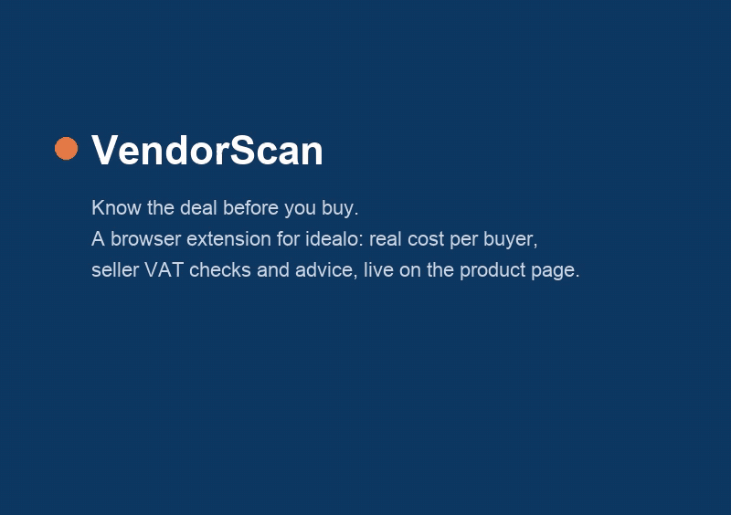
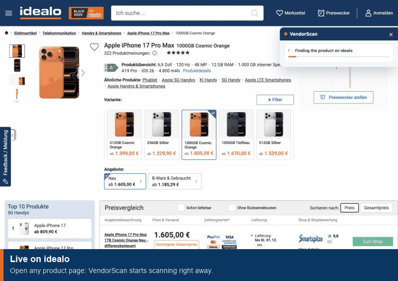
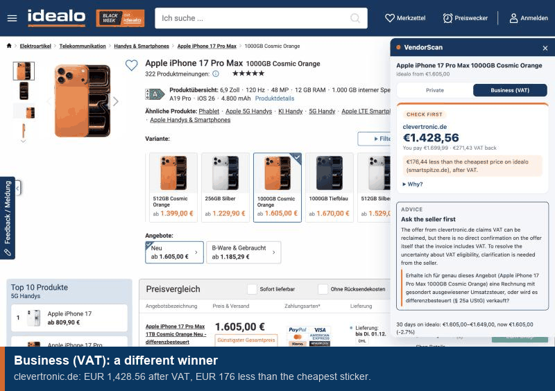
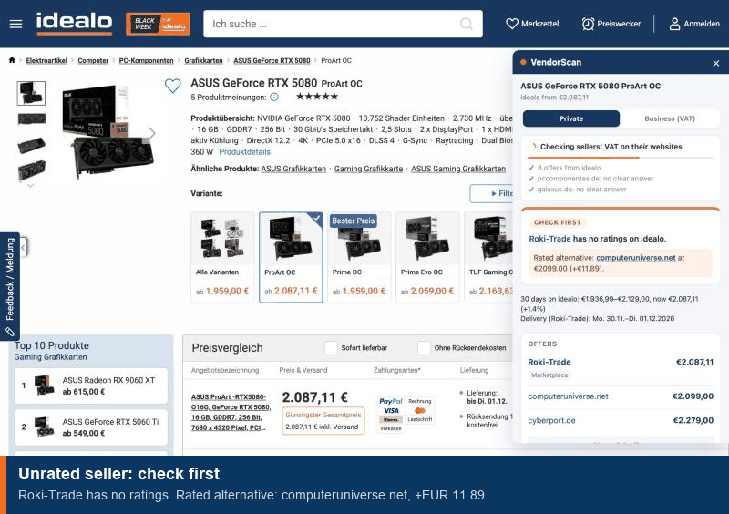
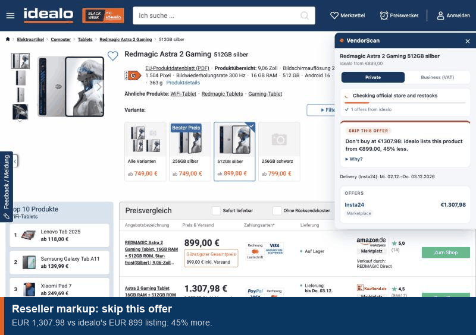

# VendorScan

Know the deal before you buy. A Chrome extension for idealo product pages that shows what
each offer really costs a private buyer or a VAT-registered business, fills gaps with web
evidence, and lets a model on Nebius Token Factory choose the next step. It never buys anything.

## See it in action



| Results stream in while it checks every seller | A VAT-registered business gets a different winner |
|---|---|
|  |  |
| **Unrated seller: check first, with a rated alternative** | **Reseller markup: skip this offer** |
|  |  |

Raw recordings of those scans: [`docs/demo/recordings/`](docs/demo/recordings/).

## Run it

```bash
python3 -m venv .venv && source .venv/bin/activate
pip install -r requirements.txt
cp -n .env.example .env       # keeps an existing .env; add TAVILY_API_KEY and NEBIUS_API_KEY
python -m vendorscan.idealo_auth   # one-time idealo sign-in in the browser
python -m vendorscan.api           # local server on 127.0.0.1:8765
```

In Chrome open `chrome://extensions`, enable **Developer mode**, choose **Load unpacked** and
pick `extension/`. Then open an idealo product page.

Tests: `python -m unittest discover -s tests`

## How it uses the challenge partners

- **idealo MCP:** product search, offers (price, shipping, shop, rating, marketplace flag,
  delivery) and 30-day price history.
- **Nebius Token Factory:** see [NEBIUS.md](NEBIUS.md).
- **Tavily:** evidence for what idealo's data leaves open.
- **Norma:** see [NORMA.md](NORMA.md).

Estimates, not tax advice.
